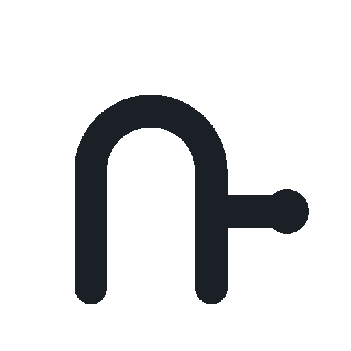

<p align="center">
  <picture>
    <source media="(prefers-color-scheme: dark)" srcset="plugin/media/icon-dark.png">
    
  </picture>
</p>

# Remote LLM Gateway

[](README.md)
[](README.ru.md)
[](LICENSE)
[](https://github.com/AlanForester/remote-llm-gateway/actions/workflows/ci.yml)
[](https://github.com/AlanForester/remote-llm-gateway/releases)
[](https://open-vsx.org/extension/alanforester/remote-llm-gateway)
[](https://hub.xerj.org/contributors/AlanForester)
[](https://github.com/AlanForester/remote-llm-gateway/stargazers)

[Русская версия README](README.ru.md)

Support the project — [star it on GitHub](https://github.com/AlanForester/remote-llm-gateway/stargazers).

> **Remote LLM Gateway** is one gateway for Grok Build, Claude Code, and GPT. The VS Code and Cursor plugin and the `remote-llm` CLI work with the local project, while the agents, tools, and MCP run on the server. This project is not affiliated with or endorsed by xAI, Anthropic, OpenAI, or Meta. The names *Grok*, *Grok Build*, *Claude Code*, *Codex*, and *Muse Code* are used only to describe compatibility.

Three ways into the same gateway:

| | **Plugin** | **CLI `remote-llm`** | **Admin** |
|---|---|---|---|
| **What it is** | A chat in the VS Code and Cursor sidebar | A terminal client that feels like `grok` or `claude` | Users, tokens, models, limits, and usage |
| **Where it lives** | `plugin/` | `cmd/remote-llm/` | `admin/` |
| **When it fits** | The project is already open in the editor | You want a terminal and do not need the editor | You need to assign a model, a proxy, and access |

The plugin and the CLI connect to the gateway over WebSocket and speak ACP (JSON-RPC). They do not call model APIs themselves. On the server the gateway starts an agent in a directory that belongs to that session. One subscription, and the keys stay on the gateway.

Sign in to Claude and the other provider CLIs on the same server that runs the gateway. Login and later use share that one address.

---

## Why

The heavy CLI does not have to sit on every machine. People open their project locally, while Grok Build, Claude Code, and GPT run on one server. An administrator sees usage, assigns a person a model and outbound internet access, and sets a token limit for a period.

### Features

<details>
<summary><strong>One gateway, one subscription</strong></summary>

Every user connects to the same gateway. Provider keys are not copied to their computers. A session is built from the user and the project: `wss://<gateway-address>/ws/{sessionId}`.

</details>

<details>
<summary><strong>Plugin for VS Code and Cursor</strong></summary>

The **Remote LLM Gateway** plugin shows a chat in the right sidebar, next to Grok. The project stays open locally: at the start of a session the files go to the gateway, and after the reply the edits are written back into the editor. The plugin does not start a local `grok` or `claude` process.

If the admin has assigned an LLM to this user, the plugin shows that model. Without an assignment, the model is chosen in the UI.

The chat UI is based on [GUI for Grok Build & Muse Code](https://github.com/phuryn/grok-build-vscode).

</details>

<details>
<summary><strong>CLI <code>remote-llm</code></strong></summary>

`remote-llm` talks to the same gateway as the plugin. From the project directory it sends files to the server and writes the edits back after the reply. `--no-sync` skips that. The short name `llm` is not used: it is too generic.

A forced model from the admin UI is shown here too.

</details>

<details>
<summary><strong>Admin</strong></summary>

The admin UI covers users, access tokens, available models, and usage: requests and tokens. It also sets the outbound proxy, the forced LLM, and the usage limit: how many tokens can be spent and when the counter resets.

`api` accepts calls with user tokens. `gateway` accepts agent sessions.

</details>

<details>
<summary><strong>Forced model</strong></summary>

An administrator assigns an LLM to a user. The plugin and the CLI show that model on screen. Without an assignment, the person picks the model.

</details>

<details>
<summary><strong>Token limit</strong></summary>

Each user has two fields in the admin UI: a token limit and a reset period. The period can be a day, a week, a month, or a custom interval. The gateway counts tokens for that period. After the limit, new requests stop until the period ends and the counter resets. Usage from earlier periods stays in the analytics.

</details>

<details>
<summary><strong>Outbound proxy</strong></summary>

Requests from Grok Build, Claude Code, and the other agents leave the server through a proxy. The address is set in the admin UI and in `.env`. Changing either value changes the exit path, and the service does not need a rebuild.

</details>

<details>
<summary><strong>A directory per session</strong></summary>

A user's files on the gateway live in that session's directory. The project path from the client is only the directory key: the gateway does not open a repository on the server at that path. Agent commands run in this directory. Edits come back to the local project.

</details>

<details>
<summary><strong>Several agents</strong></summary>

| Agent | How it starts |
|---|---|
| Grok Build | `grok agent serve`, ACP over WebSocket |
| Claude Code | `claude agent serve` |
| GPT | OpenAI Responses API and tool calling inside the gateway. One key, on the server |

For GPT the gateway supplies the tools itself: read, write, and show the session files, and run a command in the session directory. Extra tools come from stdio MCP, and the server list lives in `MCP_CONFIG`. Grok Build and Claude Code still take their MCP servers from the configuration on the gateway machine.

</details>

---

## Requirements

- VS Code or Cursor for the plugin. The terminal only needs `remote-llm`.
- A gateway server with the CLIs of the agents you enable: `grok`, `claude`.
- One subscription or one provider key on the gateway.
- Sign-in to Claude and the other provider CLIs from the same server that runs the gateway.
- Redis when the gateway, admin, and API run as separate processes or on several machines. A local `go run` without Redis stores users, limits, and the proxy in `DATA_FILE`. WebSocket sessions are not written to Redis: a live conversation does not survive a process restart.

---

## Install

The [latest release](https://github.com/AlanForester/remote-llm-gateway/releases/latest) contains the `remote-llm` binaries, a `.vsix` package, and container images for that version. The plugin is on [Open VSX](https://open-vsx.org/extension/alanforester/remote-llm-gateway). Locally, the services start from source.

```bash
cp .env.example .env
# set ADMIN_TOKEN in .env
set -a && source .env && set +a
go run ./gateway/cmd/gateway
go run ./admin/cmd/admin
go run ./api/cmd/api
```

The admin UI opens at `http://127.0.0.1:8081`. A user's token is shown once, when the user is created. Then:

```bash
go run ./cmd/remote-llm --gateway http://127.0.0.1:8080 --token <token>
```

`GATEWAY_ECHO=1` in `.env` replies with an echo and does not need `grok` or `claude` installed. For real agents, remove that variable: the gateway starts `grok agent serve` or `claude agent serve` and sends GPT to the OpenAI Responses API. Sign in to Claude and the other provider CLIs on the gateway machine.

One public entry point is described in [`deploy/nginx/nginx.conf`](deploy/nginx/nginx.conf). Nginx accepts ordinary requests and WebSocket, and the processes listen on localhost:

| Path | Goes to |
|---|---|
| `/`, `/login`, `/users`, `/proxy` | admin |
| `/v1/`, `/ws/` | gateway, including the ACP session |
| `/api/` | API, the external prefix is stripped |
| `/health`, `/health/admin`, `/health/api` | health checks of the three processes |

Then `GATEWAY_URL` points at nginx, without port `8080`. `.env.example` has a commented example.

The monorepo:

- `gateway/` — gateway, WebSocket, and ACP
- `api/` — access by user tokens
- `admin/` — web admin
- `plugin/` — VS Code and Cursor extension
- `cmd/remote-llm/` — CLI
- `deploy/` — deployment

---

## Quick start

1. Start the gateway, `api`, and admin with the commands from Install. State lives in `DATA_FILE`. Redis is not required for this step.
2. Create a user in the admin UI. Set a model, a token limit, a reset period, and a proxy if you need them.
3. In the plugin, set `remoteLlm.gatewayUrl` and save the token in Secret Storage with the command «Remote LLM: задать токен». The chat opens with «Remote LLM: открыть чат» and appears as a tab in the right sidebar. «Remote LLM: показать назначенную модель» only shows the model and usage. Or run `remote-llm` from the project directory with the same token (`--token` or `GATEWAY_TOKEN`).
4. The agent session runs on the server, in a directory for that user and project. Project files go there at the start, and changed files come back after the reply.

---

## Settings

| Setting | Where | What it does |
|---|---|---|
| Gateway address | Plugin and CLI | Where to open the WebSocket |
| User token | Plugin Secret Storage and CLI | Who is connecting |
| Forced LLM | Admin | Which model the plugin and CLI show |
| Token limit and reset period | Admin | How many tokens the user can spend before the counter resets |
| Outbound proxy | Admin and `.env` | Which exit the agents use to reach provider APIs |

The server pieces are written for Go. The plugin is JavaScript.

---

## How it works

The plugin and the CLI are thin. They open a WebSocket, pass the ACP protocol, and show the reply. The gateway owns sessions, agent startup, MCP, and command execution.

The gateway checks whether the user has an assigned model and whether the token limit for the current period is spent. It then starts the backend in that session's directory and proxies outbound calls through the proxy from the admin UI or `.env`.

---

## Development

A push and a pull request run [`.github/workflows/ci.yml`](.github/workflows/ci.yml): `gofmt`, `go vet`, `go test ./...`, the plugin check and tests, and builds of `gateway`, `api`, `admin`, and `remote-llm`. On a pull request the image job checks the `linux/amd64` build.

A push to `main` publishes `linux/amd64` and `linux/arm64` images to GitHub Container Registry. The image tag is the commit SHA, plus a moving `main` tag:

```text
ghcr.io/alanforester/remote-llm-gateway/gateway:<sha>
ghcr.io/alanforester/remote-llm-gateway/api:<sha>
ghcr.io/alanforester/remote-llm-gateway/admin:<sha>
```

A git tag `vMAJOR.MINOR.PATCH` publishes the same images with the version number (`1.2.3` and `v1.2.3`) and the same SHA. That tag builds a GitHub Release: `remote-llm` binaries for Linux, macOS, and Windows, and the plugin `.vsix`. The release notes list the image names for that version.

```bash
git tag v0.1.2
git push origin v0.1.2
```

Registry login and release creation use `GITHUB_TOKEN`, which GitHub Actions provides. Those steps have `packages: write` and `contents: write`. There is no separate token in the repository files. In Settings → Actions → General the repository must allow read and write for `GITHUB_TOKEN`, or package publishing stops on permissions.

The image is built from [`deploy/Dockerfile`](deploy/Dockerfile). Without `REDIS_URL` the three processes share the file `/data/gateway.json`. The process inside the container is user `65532`. The `gateway` image includes `git`, which agents use inside a session. `grok` and `claude` are not in the image; install them on the gateway machine. The admin process needs `ADMIN_TOKEN` and exits immediately without it. The WebSocket token is sent in the `Authorization` header, not in the URL. Nginx does not write the query string to the access log and does not publish `/metrics`.

The header carries badges for language, license, CI, and the release.

Pull requests are welcome.

---

## Deploy

On one machine the stack starts from [`deploy/docker-compose.yml`](deploy/docker-compose.yml). It includes Redis, `gateway`, `api`, `admin`, nginx, Prometheus, and Grafana. Secrets are read from `.env` next to the repository and are not baked into the image.

```bash
cp .env.example .env
# your own ADMIN_TOKEN and, if needed, OPENAI_API_KEY, OUTBOUND_PROXY
docker compose --env-file .env -f deploy/docker-compose.yml up -d --build
```

The admin UI opens on `HTTP_PORT` (80 by default). `GATEWAY_URL` for the plugin and CLI is that address, without `:8080`. Grafana listens on `127.0.0.1:3000`, Prometheus on `127.0.0.1:9090`. The dashboard is named Remote LLM Gateway. Process metrics: `remote_llm_http_requests_total`, `remote_llm_tokens_total`, `remote_llm_quota_denied_total`, `remote_llm_sessions`. Nginx does not expose them.

`IMAGE_TAG=local` builds images from [`deploy/Dockerfile`](deploy/Dockerfile). After a publish to GHCR the same file can start without a build:

```bash
IMAGE_TAG=0.1.2 docker compose --env-file .env -f deploy/docker-compose.yml pull
IMAGE_TAG=0.1.2 docker compose --env-file .env -f deploy/docker-compose.yml up -d
```

`GATEWAY_ECHO=1` in `.env` keeps the echo. For real agents set it to `0`: `grok` and `claude` must be available to the gateway process.

To update a VPS, change `IMAGE_TAG` to a commit SHA from `main` or to a release number, then run `pull` and `up -d` again. Redis and the worktree directory live in the `redis-data` and `workspaces` volumes, and `up` does not erase them.

Kubernetes manifests are in [`deploy/k8s`](deploy/k8s). They include the same processes. The secret is not stored in the repository:

```bash
kubectl apply -f deploy/k8s/namespace.yaml
kubectl -n remote-llm create secret generic remote-llm \
  --from-literal=ADMIN_TOKEN=... \
  --from-literal=OPENAI_API_KEY=... \
  --from-literal=OUTBOUND_PROXY= \
  --from-literal=GRAFANA_ADMIN_PASSWORD=...
kubectl apply -k deploy
```

The default image tag is `main`. Another version is set with `newTag` in [`deploy/kustomization.yaml`](deploy/kustomization.yaml). The `nginx` Service of type LoadBalancer opens port 80. On a VPS without a load balancer, change the type to NodePort. Grafana stays inside the cluster: `kubectl -n remote-llm port-forward svc/grafana 3000:3000`. The manifest sets `GATEWAY_ECHO=1`; for production agents change the value in `deploy/k8s/apps.yaml` and apply the kustomization again. If the cluster cannot pull the image, make the GHCR package public or add an `imagePullSecret`.

---

## Limits

- The plugin is on [Open VSX](https://open-vsx.org/extension/alanforester/remote-llm-gateway). A `.vsix` is also in the [latest release](https://github.com/AlanForester/remote-llm-gateway/releases/latest).
- Provider account sign-in happens on the gateway server. It does not work from the user's own machine.
- GPT connects through the OpenAI Responses API inside the gateway. There is no separate Codex process.

---

## License

MIT. The text is in [LICENSE](LICENSE).

The plugin UI is based on [phuryn/grok-build-vscode](https://github.com/phuryn/grok-build-vscode). That project has its own license. This repository is published under MIT.
